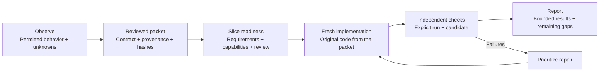

<div align="center">

# 🧹 The Maid - ReBuild

**Observe the behavior. Write an original implementation. Bring the proof.**

A practical agent skill for turning permitted research into a reviewed contract,
a ready implementation slice, and reproducible acceptance evidence.

  

[The method](#the-method) · [Quick start](#quick-start) · [Try it](#try-it) · [Evidence](#evidence-so-far) · [Reference](#reference)

</div>

---

Good rebuilds start with the user's exact request and a clear account of what a product does—and end with evidence against that requested objective. A narrowed contract or attractive redesign cannot silently replace a faithful rebuild. The Maid keeps observations, design decisions, permissions, unknowns, and test results connected along the way.

Bring your own product, stack, and authorized access. The kit supplies the method, reusable records, and local checks. Its core Python tools use only the standard library and run offline; validators and reporters read records without changing them.

> **New command and display name.** Install and invoke **`$the-maid-rebuild`**, displayed as **The Maid - ReBuild**. It replaces `$behavior-rebuild`; the old command is not an alias. Archive filename prefixes `behavior-rebuild-kit` / `behavior-rebuild-skill` remain stable, while the standalone archive now contains `the-maid-rebuild/`.

## The method



| 🔎 Discover | 📦 Handoff | 🧪 Verify / recover |
|---|---|---|
| Find out what the workflow does. | Prepare what the builder needs. | Check what the candidate actually achieves. |
| Scoped observations, source-use decisions, unknowns, and exclusions. | An original implementation contract, reviewed packet, hashes, and exposure records. | Explicit acceptance evidence, open gaps, and prioritized repair work. |

Lock the requested objective as faithful reimplementation, user-authorized original redesign, or explicitly bounded workflow. Inventory all requested surfaces before handoff and keep intent review separate from packet review. Unknown evidence blocks the relevant fidelity claim; it does not grant permission to reduce scope.

Before starting implementation, distinguish an approved packet, a ready slice and full requested scope. A ready backend slice can proceed while unrelated visual discovery is blocked; unresolved whole-product scope stays visible.

Choose one mode per task. Keep research, implementation, and review in separate contexts where required, and disclose prior exposure. The skill guides that work; it does not execute target access or create an isolation boundary.

## Quick start

Requires **Python 3.11+** and Codex. This repository is private: authenticate GitHub CLI with an account that has access before cloning.

```sh
gh repo clone oabdelmaksoud/the-maid-clean-room-rebuild
cd the-maid-clean-room-rebuild
```

Copy the **complete command pack** from the repository root. It contains the shared core and all nine phase/full-workflow commands. This standard-library command uses your configured `CODEX_HOME`, or defaults to `~/.codex`. It refuses to overwrite an existing installation and leaves the source folder unchanged.

```sh
python3 -c "import os, shutil; from pathlib import Path; source = Path('skills'); destination = Path(os.environ.get('CODEX_HOME') or Path.home() / '.codex') / 'skills'; folders = sorted(source.glob('the-maid-*'), key=lambda p: (p.name != 'the-maid-rebuild', p.name)); assert folders and (source / 'the-maid-rebuild' / 'SKILL.md').is_file(), 'Shared core missing'; assert all(not (destination / p.name).exists() and not (destination / p.name).is_symlink() for p in folders), 'Review and back up the existing Maid installation first'; destination.mkdir(parents=True, exist_ok=True); [shutil.copytree(p, destination / p.name, ignore=shutil.ignore_patterns('__pycache__', '*.pyc')) for p in folders]; print(destination)"
```

On macOS, Linux, or Windows, use `python` instead if that is the name of your Python 3.11+ executable. Review an existing installation before replacing it. No plugin wrapper or package dependency is needed.

If upgrading from `$behavior-rebuild`, first use the installation command above to copy the new folder. Review the old installation, then move it outside the active skills directory to avoid duplicate commands. This migration command preserves it as a backup and refuses an existing backup path:

```sh
python3 -c "import os, shutil; from pathlib import Path; base = Path(os.environ.get('CODEX_HOME') or Path.home() / '.codex'); old = base / 'skills' / 'behavior-rebuild'; new = base / 'skills' / 'the-maid-rebuild'; backup = base / 'skill-backups' / 'behavior-rebuild-0.3.0'; assert new.is_dir(), 'Install the new skill first'; assert old.is_dir(), 'Old installation not found'; assert not backup.exists(), 'Review the existing backup first'; backup.parent.mkdir(parents=True, exist_ok=True); old.rename(backup); print(backup)"
```

Start a fresh Codex turn after installation or migration so skill discovery loads the new identifier. No installed skills are changed by cloning, testing or building this repository.


## Pick a command

These are separate Codex commands. Replace `[target]` with a product URL, installed app name, or project path; use a saved project/evidence directory for later phases.

| Command | What it does |
|---|---|
| `$the-maid-discover [target]` | Inventory the product, workflows, states, sources and gaps. |
| `$the-maid-rea [target]` | Use connected REA for permitted screenshot observation and a reviewed evidence handoff. |
| `$the-maid-spec [project]` | Create canonical requirements, acceptance cases and the reviewed implementation packet. |
| `$the-maid-ready [project]` | Check whether the requested implementation slices are ready. |
| `$the-maid-build [project]` | Implement approved ready slices from the packet. |
| `$the-maid-validate [project]` | Compare behavior, appearance, journeys and files; report fidelity gaps. |
| `$the-maid-repair [project]` | Fix reproducible gaps and independently rerun the checks. |
| `$the-maid-status [project]` | Read current progress, blockers and the next action without modifying the project. |
| **`$the-maid-all [target]`** | **Run the full authorized workflow, including validation and repair.** |

Each phase stops at its stated outcome. Validation does not silently rewrite the app; discovery does not start a build. `all` preserves the requested full scope, progresses through ready slices and retains explicit blockers when access or evidence prevents completion. REA is used when connected, useful and permitted; its absence does not broaden source access. None of these commands independently authorizes publishing, account changes or new installations.

`$the-maid-rebuild` still accepts natural-language requests for compatibility. For the distinct command names, install the **whole command pack**, including their shared `the-maid-rebuild` folder. See the [mode guide](skills/the-maid-rebuild/references/commands.md).

The [skill instructions](skills/the-maid-rebuild/SKILL.md) describe the full workflow. The [compatibility record](docs/compatibility.md) states observed host coverage.

## Try it

**Delimited Notebook** is an original fictional CSV workflow with synthetic inputs. Start by inspecting its static records:

```sh
python3 skills/the-maid-rebuild/scripts/validate.py examples/delimited-notebook --stage discover
python3 skills/the-maid-rebuild/scripts/validate.py examples/delimited-notebook --stage handoff
python3 skills/the-maid-rebuild/scripts/report.py examples/delimited-notebook
```

Those records have no executed acceptance run. A discovery or handoff pass is not product acceptance.

To generate fresh demonstration evidence, choose a **new output directory**:

```sh
python3 examples/delimited-notebook/run_demo.py --output ../behavior-rebuild-demo
python3 skills/the-maid-rebuild/scripts/validate.py ../behavior-rebuild-demo --stage acceptance --run runs/demo.json --candidate demo-v1
python3 skills/the-maid-rebuild/scripts/report.py ../behavior-rebuild-demo --run runs/demo.json --candidate demo-v1
```

The runner writes only its new output directory. The example checks its declared total/export and invalid-amount behavior; crash recovery, cancellation, and receipt/idempotency guarantees remain extension work. Its recorded reviewer represents automated fixture checks. Read the [example guide](examples/delimited-notebook/README.md) for the exact oracle scope.

## See the screen. Follow the journey.

The Maid now checks two UI evidence types alongside output assertions:

| Check | What it catches | What you freeze first |
|---|---|---|
| **Visual pixels** | A rendered checkpoint that differs beyond its declared RGB pixel budgets. | Hashed baseline, dimensions, capture conditions, and tolerances. |
| **Journey trace** | Missing/reordered actions or incorrect observed DOM, storage, or output state. | Ordered actions and exact, typed state assertions. |

These are separate gates: a correct-looking button can still fail after a click or reload. A baseline from an approved original design supports candidate regression, not fidelity to the target. Faithful rebuilds require paired target/candidate evidence, actual native execution where requested, and real file exchange when compatibility is required. Every automated pass claim is recomputed from the recorded output. Browser capture is separate from the offline validator; the optional browser example uses Playwright and Pillow.

```text
$the-maid-rebuild Verify/recover this UI using visual and user-journey validation. Freeze the permitted baselines, capture conditions, and ordered state assertions before execution. Compare the current checks with the added checks using deliberate visual and persistence faults, preserve failures, and independently rerun repairs. Keep REA optional.
```

Start with the [UI validation template](skills/the-maid-rebuild/assets/templates/ui-validation.md) and [capture guide](skills/the-maid-rebuild/references/visual-and-journey.md). The [Pocket Tasks project](examples/pocket-tasks/README.md) demonstrates the baseline-versus-expanded comparison in a real browser.

To reproduce the browser comparison, follow the example's [optional dependency setup](examples/pocket-tasks/README.md#run-it), then run from this repository root with a **new output directory**:

```sh
/tmp/maid-browser-python/bin/python examples/pocket-tasks/run_trial.py \
  --output /tmp/maid-pocket-trial \
  --playwright-module /tmp/maid-browser-node/node_modules/playwright
```

The macOS/Linux example paths above assume the documented setup: a separate Python environment with Pillow and a separate Node directory with Playwright and Chromium. Browser dependencies are required only for capture. The runner retains failed evidence, compares the narrow and expanded suites, and checks the generated records with the portable validator.

## REA, connected to The Maid

**REA now has a supported discovery path**, with scoped screenshot capture, reviewed behavioral observations, and an offline evidence/handoff gate. Keep capture files outside the author packet; hand off only independently reviewed behavioral records. REA remains optional for other projects.

```text
$the-maid-rebuild Use REA for permitted screenshot discovery of this product. Keep source and network inspection excluded, measure the UI, review the observations, and run the REA evidence and slice-readiness gates before the implementation handoff.
```

The [REA integration guide](skills/the-maid-rebuild/references/rea-integration.md) covers pinned setup, the limited Codex tool profile, capture prerequisites, record format, and fallback behavior. The tested integration targets `rea-agents@6.4.0`; it is an external tool rather than bundled code.

```sh
python3 skills/the-maid-rebuild/scripts/rea.py PROJECT_DIR --json
python3 examples/rea-observation/run_trial.py --output ../rea-observation-trial
```

A separate live smoke test used REA 6.4.0 to capture an original isolated local page, independently checked the PNG bytes and dimensions, and confirmed rejection of a disallowed origin. It did not access Manus, accounts, target source, or personal browser data.

The synthetic trial tests the handoff controls without installing REA or accessing a product. A live REA screenshot proves a recorded capture, not product completeness or clone fidelity. The gate checks files and declarations; it cannot authenticate permission, detect all sensitive content, or verify that a screenshot came from REA. Those remain review responsibilities.

> **Portable by default.** Core checks remain offline and use the Python standard library. REA and Replica are not dependencies of the existing fidelity or readiness gates. Source/bundle/network inspection and copied assets remain excluded from The Maid's clean-room profile.


## Fidelity beyond a passing subset

The [fidelity guide](skills/the-maid-rebuild/references/fidelity.md) keeps the original request, complete surface/feature inventory and reviewed objective linked to an explicit candidate. Use the [fidelity contract](skills/the-maid-rebuild/assets/templates/fidelity-contract.json) and [evaluation record](skills/the-maid-rebuild/assets/templates/fidelity.json) alongside existing project records:

```sh
python3 skills/the-maid-rebuild/scripts/fidelity.py PROJECT_DIR --json
```

The local gate checks hashes, case bindings and recorded outcomes. It does not observe the product or authenticate the records. Report matched, mismatched, unknown and user-authorized deviations per dimension, retaining every inventoried feature in denominators. Existing bounded projects remain supported and their results stay bounded.

**Chess retest: the old bounded acceptance still passes; faithful acceptance is blocked.** The unchanged Quiet Knight candidate passed a fresh 476-rule-test run and its previous five-case evidence gate. The new fidelity assessment records **15 feature groups: 4 matches, 7 mismatches and 4 unknowns**, with no authorized deviations. It rejects the original-design visual baselines and flags incomplete target discovery. These are counts within the recorded inventory, not a whole-product fidelity percentage.

Fresh native inspection confirmed reference variants, styles, speech settings and document-menu entries, and compared the rebuilt app's setup and menu. Other evidence is explicitly retrospective; the trial does not perform exhaustive native automation or claim the chess app has been repaired. See the [reproducible chess assessment](examples/chess-fidelity/README.md).

```sh
python3 examples/chess-fidelity/run_trial.py --output ../chess-fidelity-trial
```

The trial succeeds only when the fidelity gate rejects the known gaps and its negative controls return the expected failures. The standalone fidelity command returns exit `1` for this chess candidate.

## Ready to build, one slice at a time

Before implementing a new faithful slice, copy the [blocked readiness starter](skills/the-maid-rebuild/assets/templates/readiness-starter) and follow the [guide](skills/the-maid-rebuild/references/implementation-readiness.md). Freeze `readiness-contract.json`, bind it from `readiness.json`, and select explicit requested slice IDs:

```sh
python3 skills/the-maid-rebuild/scripts/readiness.py PROJECT_DIR --json
```

The gate checks canonical requirements against a hashed author packet, applicable slice coverage, recorded review, declared capabilities, comparable capture conditions and matching target IDs in dispatch/resume records. It rejects a ready claim with unavailable required dependencies or conflicting states. A provisional record can pass for ready selected slices while preserving required blocked scope. That pass means those local records meet the slice gate; it does not establish a complete product.

After a failure, preserve the old candidate and evidence, repair accessible gaps, then independently rerun unchanged requirements against a new candidate. Closure checks recorded candidate/reviewer identity and a hashed rerun; real execution and review still supply the proof. The starter records are intentionally unresolved. Existing bounded examples continue to work without readiness migration.

Run the original synthetic record trial to see a conflicting packet rejected, a corrected slice accepted, independent backend work accepted provisionally, and a false full-scope readiness claim rejected:

```sh
python3 examples/manus-readiness/run_trial.py --output ../manus-readiness-trial
```

Choose a new output directory; the runner retains fixture records and `results.json` there. This trial uses synthetic records inspired by the Manus findings; it neither accesses nor evaluates Manus.

```text
$the-maid-rebuild Prepare a ready implementation slice from permitted evidence. Reconcile the canonical requirements with the author packet, plan real capabilities, freeze measured visual specifications where applicable, and run the readiness gate. Keep the full requested scope and blocked discovery visible.
```

## What the Manus trial taught us

The Manus trial caught more gaps than it prevented. Approximate layout prose, conflicting profile labels and a packet approved only for known behavior let implementation start before the relevant states and capabilities were ready. A working file-producing agent did not establish the target's browser, generation or cloud workflows. The final assessment retained known UI mismatches.

Its **4 matched / 22 mismatched / 28 unknown** obligations are a historical contract count, not an accuracy percentage. That contract mixed source documents, broad unknown surfaces and visual cases. Version 0.4.0 added a slice-readiness record gate and sharpens the workflow: reconcile author/evaluator requirements, measure layouts, match capture conditions, plan each real capability and keep failed runs in a repair loop. Inventory normalization and broader paired task rubrics still require review and actual execution; the tools do not observe products or supply missing services.

No Manus screenshots, source or assets are bundled. The trial's local findings guide the method; they do not establish that Manus has been rebuilt or that full product equivalence is attainable through a skill alone.

## Evidence so far

| Observed check | Result and boundary |
|---|---|
| **Pocket Tasks browser comparison** | The narrow add-task check passed despite three seeded defects. Added visual/journey checks caught missing blank-input feedback, lost tasks after reload, and broken mobile layout; the repaired variant passed all five cases. Each isolated fault failed its corresponding added check. [Reproduce the trial](examples/pocket-tasks/README.md). |
| **Historical 0.1.0: 36 tests × six CI combinations** | Linux, macOS, and Windows on Python 3.11 and 3.14. All jobs passed the tests, demo, explicit acceptance gate, and release build in [run 38187975934](https://github.com/oabdelmaksoud/the-maid-clean-room-rebuild/actions/runs/38187975934). |
| **Installed-skill project trial** | 141/141 comparisons and 80/80 independent review probes passed within a bounded sorting contract. Negative controls rejected failed behavior, forged declarations, mismatched candidates, and tampered packets. [Trial details](docs/project-trial.md). |
| **Native Codex trials** | Bounded project-local and global installed trials completed. Claude native behavior remains unverified because authentication blocked its trial. [Host coverage](docs/compatibility.md). |

Pocket Tasks is a controlled experiment on an original app with known faults, not an independent clean-room rebuild. It demonstrates the benefit of the added coverage; richer assertions could also have used the earlier JSON oracle.

These are finite checks of declared scope. They do not establish full product parity, production readiness, legal clearance, or forensic independence. The [verification record](docs/release-verification.md) identifies the tested revisions and historical checkpoints.

## Reference

Start a real project with the [templates](skills/the-maid-rebuild/assets/templates). The starter `project.json` is deliberately **blocked** until it contains meaningful scope and evidence. Keep restricted raw research outside the distributable packet.

| Read this | For this |
|---|---|
| [Method](docs/method.md) | Research, handoff, implementation, and review boundaries. |
| [Fidelity](skills/the-maid-rebuild/references/fidelity.md) | Original request, inventory, paired runtime evidence and dimensional coverage. |
| [Implementation readiness](skills/the-maid-rebuild/references/implementation-readiness.md) | Slice gates, canonical requirements, capability plans and target continuity. |
| [Record format](skills/the-maid-rebuild/references/record-format.md) | Exact fields in the bespoke versioned JSON records. |
| [Visual and journey validation](skills/the-maid-rebuild/references/visual-and-journey.md) | Frozen visual baselines, ordered state assertions, capture conditions, and limitations. |
| [Quality gates](docs/quality-gates.md) | What each check can support. |
| [Evidence boundary](docs/evidence-boundary.md) | Limits of hashes, declarations, and recorded outcomes. |
| [Publication checklist](docs/publication-checklist.md) | Conditions to check before distribution. |
| [Contributing](CONTRIBUTING.md) · [Security](SECURITY.md) | Development guidance and security reporting. |

<details>
<summary><strong>Acceptance records, exit codes, and trust boundaries</strong></summary>

Acceptance requires an **explicit run and candidate**. Tools never select a newest run automatically. A run binds the exact `project.json` bytes: changing the manifest invalidates that binding, so retain historical records and produce a new run.

Add `--json` to the validator or reporter for structured output. Validator `--digest` prints manifest identity, not gate approval.

| Exit | Meaning |
|---|---|
| `0` | The selected supported structural or recorded-evidence gate passed. |
| `1` | Records are well formed, but the selected gate is blocked or failed. |
| `2` | Invalid input, path, integrity, or invocation. |

Track documented, observed, reported, and unknown claims separately from proposed original design. Record observation, handoff, and publication permissions explicitly; a local handoff approval does not grant publication permission.

Hashes establish file identity. Permission and reviewer declarations cannot establish their own truth, and records alone cannot prove correct real-world outcomes. Validate a trusted, quiescent local copy: another process must not replace files or path components during a check. The tools are not a sandbox for a concurrently hostile filesystem.

</details>

<details>
<summary><strong>Development and release archives</strong></summary>

Run the test suite from the repository root:

```sh
python3 -m unittest discover -s tests -v
```

Build archives into a **new directory outside the repository**:

```sh
python3 tools/build_release.py --output ../behavior-rebuild-release
```

The builder checks the tree against `release-files.txt`, then creates:

- `behavior-rebuild-kit-0.6.0.zip` — repository resources.
- `behavior-rebuild-skill-0.6.0.zip` — the shared `the-maid-rebuild/` folder and all phase/full-workflow command folders; install them together.
- `SHA256SUMS` — archive byte identities.

Choose a different destination if it already exists. Adding or removing a release file requires updating the inventory. Archives, hashes, and local preparation do not publish anything or constitute publication approval.

</details>

---

Original material is [MIT licensed](LICENSE). [NOTICE](NOTICE.md) attributes pinned Storytold inspiration and discloses source exposure. No Storytold implementation or proprietary target material is bundled.
