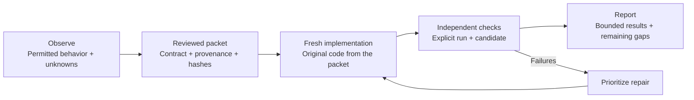

<div align="center">

# 🧹 The Maid - Clean Room Rebuild

**Observe the behavior. Write an original implementation. Bring the proof.**

A practical agent skill for turning permitted research into a reviewed contract,
a fresh implementation, and reproducible acceptance evidence.

  

[The method](#the-method) · [Quick start](#quick-start) · [Try it](#try-it) · [Evidence](#evidence-so-far) · [Reference](#reference)

</div>

---

Good rebuilds start with a clear account of what a product does—and end with evidence that the new implementation meets its declared contract. The Maid keeps observations, design decisions, permissions, unknowns, and test results connected along the way.

Bring your own product, stack, and authorized access. The kit supplies the method, reusable records, and local checks. Its Python tools use only the standard library and run offline; validators and reporters read records without changing them.

> **New name, stable skill.** The Maid is the project brand. Install and invoke **`$behavior-rebuild`** as before. Skill paths, CLI commands, and the `behavior-rebuild-kit` / `behavior-rebuild-skill` archive names remain stable.

## The method



| 🔎 Discover | 📦 Handoff | 🧪 Verify / recover |
|---|---|---|
| Find out what the workflow does. | Prepare what the builder needs. | Check what the candidate actually achieves. |
| Scoped observations, source-use decisions, unknowns, and exclusions. | An original implementation contract, reviewed packet, hashes, and exposure records. | Explicit acceptance evidence, open gaps, and prioritized repair work. |

Choose one mode per task. Keep research, implementation, and review in separate contexts where required, and disclose prior exposure. The skill guides that work; it does not execute target access or create an isolation boundary.

## Quick start

Requires **Python 3.11+** and Codex. This repository is private: authenticate GitHub CLI with an account that has access before cloning.

```sh
gh repo clone oabdelmaksoud/the-maid-clean-room-rebuild
cd the-maid-clean-room-rebuild
```

Copy the **complete skill folder** from the repository root. This standard-library command uses your configured `CODEX_HOME`, or defaults to `~/.codex`. It refuses to overwrite an existing installation and leaves the source folder unchanged.

```sh
python3 -c "import os, shutil; from pathlib import Path; source = Path('skills/behavior-rebuild'); destination = Path(os.environ.get('CODEX_HOME') or Path.home() / '.codex') / 'skills' / 'behavior-rebuild'; shutil.copytree(source, destination, ignore=shutil.ignore_patterns('__pycache__', '*.pyc')); print(destination)"
```

On macOS, Linux, or Windows, use `python` instead if that is the name of your Python 3.11+ executable. Review an existing installation before replacing it. No plugin wrapper or package dependency is needed.

Start a new Codex turn, then choose a mode:

```text
$behavior-rebuild Discover the permitted behavior of this workflow. Record evidence, exclusions, and unknowns.
```

```text
$behavior-rebuild Prepare a handoff from this approved evidence. Freeze the packet and arrange separate review.
```

```text
$behavior-rebuild Verify/recover this implementation against its frozen contract. Report failures and rank repair work.
```

The [skill instructions](skills/behavior-rebuild/SKILL.md) describe the full workflow. The [compatibility record](docs/compatibility.md) states observed host coverage.

## Try it

**Delimited Notebook** is an original fictional CSV workflow with synthetic inputs. Start by inspecting its static records:

```sh
python3 skills/behavior-rebuild/scripts/validate.py examples/delimited-notebook --stage discover
python3 skills/behavior-rebuild/scripts/validate.py examples/delimited-notebook --stage handoff
python3 skills/behavior-rebuild/scripts/report.py examples/delimited-notebook
```

Those records have no executed acceptance run. A discovery or handoff pass is not product acceptance.

To generate fresh demonstration evidence, choose a **new output directory**:

```sh
python3 examples/delimited-notebook/run_demo.py --output ../behavior-rebuild-demo
python3 skills/behavior-rebuild/scripts/validate.py ../behavior-rebuild-demo --stage acceptance --run runs/demo.json --candidate demo-v1
python3 skills/behavior-rebuild/scripts/report.py ../behavior-rebuild-demo --run runs/demo.json --candidate demo-v1
```

The runner writes only its new output directory. The example checks its declared total/export and invalid-amount behavior; crash recovery, cancellation, and receipt/idempotency guarantees remain extension work. Its recorded reviewer represents automated fixture checks. Read the [example guide](examples/delimited-notebook/README.md) for the exact oracle scope.

## Evidence so far

| Observed check | Result and boundary |
|---|---|
| **36 tests × six CI combinations** | Linux, macOS, and Windows on Python 3.11 and 3.14. All jobs passed the tests, demo, explicit acceptance gate, and release build in [run 38187975934](https://github.com/oabdelmaksoud/the-maid-clean-room-rebuild/actions/runs/38187975934). |
| **Installed-skill project trial** | 141/141 comparisons and 80/80 independent review probes passed within a bounded sorting contract. Negative controls rejected failed behavior, forged declarations, mismatched candidates, and tampered packets. [Trial details](docs/project-trial.md). |
| **Native Codex trials** | Bounded project-local and global installed trials completed. Claude native behavior remains unverified because authentication blocked its trial. [Host coverage](docs/compatibility.md). |

These are finite checks of declared scope. They do not establish full product parity, production readiness, legal clearance, or forensic independence. The [verification record](docs/release-verification.md) identifies the tested revisions and historical checkpoints.

## Reference

Start a real project with the [templates](skills/behavior-rebuild/assets/templates). The starter `project.json` is deliberately **blocked** until it contains meaningful scope and evidence. Keep restricted raw research outside the distributable packet.

| Read this | For this |
|---|---|
| [Method](docs/method.md) | Research, handoff, implementation, and review boundaries. |
| [Record format](skills/behavior-rebuild/references/record-format.md) | Exact fields in the bespoke versioned JSON records. |
| [Quality gates](docs/quality-gates.md) | What each check can support. |
| [Evidence boundary](docs/evidence-boundary.md) | Limits of hashes, declarations, and recorded outcomes. |
| [Publication checklist](docs/publication-checklist.md) | Conditions to check before distribution. |
| [Contributing](CONTRIBUTING.md) · [Security](SECURITY.md) | Development guidance and security reporting. |

<details>
<summary><strong>Acceptance records, exit codes, and trust boundaries</strong></summary>

Acceptance requires an **explicit run and candidate**. Tools never select a newest run automatically. A run binds the exact `project.json` bytes: changing the manifest invalidates that binding, so retain historical records and produce a new run.

Add `--json` to the validator or reporter for structured output. Validator `--digest` prints manifest identity, not gate approval.

| Exit | Meaning |
|---|---|
| `0` | The selected supported structural or recorded-evidence gate passed. |
| `1` | Records are well formed, but the selected gate is blocked or failed. |
| `2` | Invalid input, path, integrity, or invocation. |

Track documented, observed, reported, and unknown claims separately from proposed original design. Record observation, handoff, and publication permissions explicitly; a local handoff approval does not grant publication permission.

Hashes establish file identity. Permission and reviewer declarations cannot establish their own truth, and records alone cannot prove correct real-world outcomes. Validate a trusted, quiescent local copy: another process must not replace files or path components during a check. The tools are not a sandbox for a concurrently hostile filesystem.

</details>

<details>
<summary><strong>Development and release archives</strong></summary>

Run the test suite from the repository root:

```sh
python3 -m unittest discover -s tests -v
```

Build archives into a **new directory outside the repository**:

```sh
python3 tools/build_release.py --output ../behavior-rebuild-release
```

The builder checks the tree against `release-files.txt`, then creates:

- `behavior-rebuild-kit-0.1.0.zip` — repository resources.
- `behavior-rebuild-skill-0.1.0.zip` — the self-contained `behavior-rebuild/` folder.
- `SHA256SUMS` — archive byte identities.

Choose a different destination if it already exists. Adding or removing a release file requires updating the inventory. Archives, hashes, and local preparation do not publish anything or constitute publication approval.

</details>

---

Original material is [MIT licensed](LICENSE). [NOTICE](NOTICE.md) attributes pinned Storytold inspiration and discloses source exposure. No Storytold implementation or proprietary target material is bundled.
